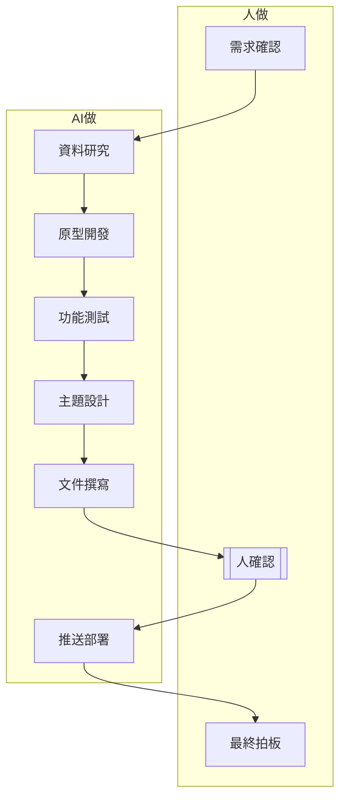

# 流程圖與 RACI

## 流程圖



## RACI 表

| 步驟 | R 動手做 | A 拍板負責 | C 先問誰 | I 通知誰 |
|---|---|---|---|---|
| 需求確認 | 組員一 | 組員二 | — | — |
| 資料研究 | AI | 組員一 | 組員二 | — |
| 原型開發 | AI | 組員二 | 組員一 | — |
| 功能測試 | AI | 組員一 | 組員二 | — |
| 主題設計 | AI | 組員二 | 組員一 | — |
| 文件撰寫 | AI | 組員一 | 組員二 | — |
| 人確認 | 組員二 | 組員一 | — | — |
| 推送部署 | AI | 組員二 | 組員一 | — |
```